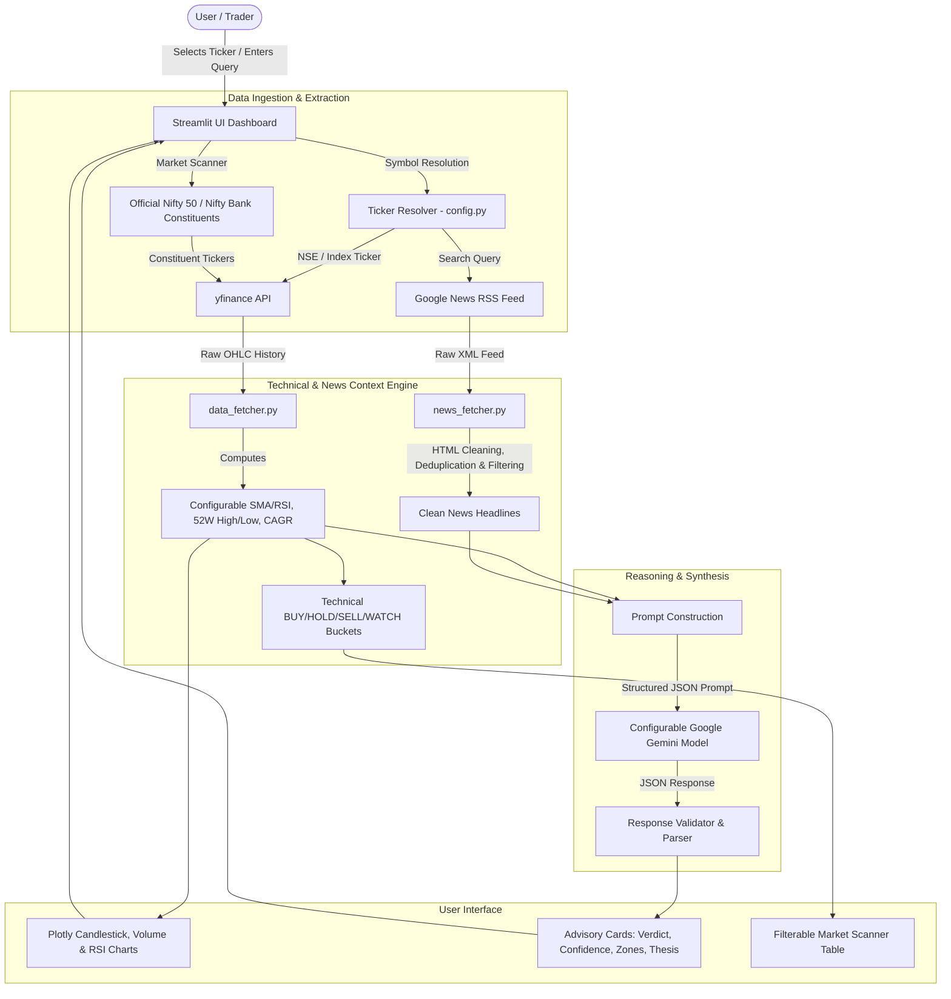

# 🧠 TradeMind: Knowledge Base & Architecture Blueprint

## 1. Executive Summary & Vision
**TradeMind** is an AI-powered stock market co-pilot and decision-support tool tailored for the Indian stock market (**NSE/BSE**), defaulting to **Nifty 50** and **Nifty Bank**, with full support for individual equities.

Traditional retail traders often face information asymmetry: technical charts require manual pattern recognition, multi-year historical context is cumbersome to compile, and real-time public news is scattered across multiple portals. **TradeMind bridges this gap using Large Language Models (LLMs)**.

### Core Philosophy
* **Helper / Advisor, NOT an Auto-Trader**: TradeMind does not execute orders or access brokerage trading accounts. It functions as an analytical companion that aids human judgment.
* **Dual-Signal Synthesis**: A recommendation is never based purely on technical indicators or purely on news headlines alone. TradeMind combines the **user-selected price history** with **current public news context**.
* **Low-Cost Data Architecture**: Built using open protocols (`yfinance` for OHLC history + Google News RSS for headlines) without requiring a paid financial data subscription. Providers may still rate-limit or return incomplete data.

---

## 2. System Architecture

---

## 3. Component Deep Dive

### 3.1. Symbol Resolution (`src/config.py`)
- Maps common phrases (`"Nifty"`, `"Bank Nifty"`) to their official Yahoo Finance symbols (`^NSEI`, `^NSEBANK`).
- Contains presets for high-market-cap Indian equities (Reliance, TCS, HDFC Bank, Infosys, Tata Motors, etc.).
- Normalizes user searches to standard National Stock Exchange notation (e.g. appending `.NS` or `.BO`).

The same module fetches current constituent CSV files from [NSE Indices Nifty 50](https://www.niftyindices.com/indices/equity/broad-based-indices/nifty--50)
and [Nifty Bank](https://www.niftyindices.com/indices/equity/sectoral-indices/nifty-bank).
This keeps the scanner aligned with index membership changes instead of relying
only on a hand-maintained stock list. If the official files are unavailable,
the scanner reports that the universe could not be loaded rather than silently
showing stale constituents.

### 3.2. Technical Engine (`src/data_fetcher.py`)
Fetches the selected daily history window (preset options range from 1 month to 10 years, plus `Max`) and computes:
- **Momentum Indicators**: 14-period Relative Strength Index (RSI), detecting overbought (>70) and oversold (<30) conditions.
- **Trend Alignment**: Configurable short/long Simple Moving Averages (SMA), defaulting to 50-day and 200-day windows, identifying bullish/bearish alignment when both averages are available. Short windows are explicitly marked as having insufficient history rather than being labeled bearish.
- **Price Envelope**: 52-week High and 52-week Low with percentage distance.
- **Compound Annual Growth Rates (CAGR)**: 1-Year, 3-Year, 5-Year, and 10-Year historical compounded growth rates when the selected window contains enough observations.

### 3.3. Market Scanner (`src/scanner.py`)

- Merges the current Nifty 50 and Nifty Bank constituents, removing duplicate bank constituents from the combined view.
- Fetches technical data concurrently and caches the resulting snapshot for the configured cache interval (15 minutes by default) in the UI. The sidebar refresh control clears this cache.
- Assigns transparent screening buckets using SMA alignment and RSI: `BUY`, `HOLD`, `SELL`, `WATCH`, or unavailable.
- The scanner is intentionally technical and local; it does not make one Gemini request per company. Any row can be opened in the detailed single-asset view for optional AI synthesis.

### 3.4. News Context Pipeline (`src/news_fetcher.py`)
- Queries Google News RSS with geo-targeted Indian business feeds (`hl=en-IN&gl=IN&ceid=IN:en`).
- Extracts news headlines, publication dates, and media sources (e.g., Moneycontrol, Economic Times, Livemint, Business Standard).
- Removes RSS/HTML formatting, deduplicates items, and passes lean headline representations to the LLM. Sentiment is interpreted by Gemini rather than independently calculated by this module.

### 3.5. LLM Synthesis & Reasoning Engine (`src/llm_analyzer.py`)
- **Model**: Configurable Google Gemini model. The default and fallbacks are set through `GEMINI_MODEL` and `GEMINI_FALLBACK_MODELS` in `.env`.
- **Input Context**: Basic Yahoo metadata, price action, moving average alignments, RSI momentum, available multi-year returns, and up to the configured news headline limit (8 by default).
- **Validated Output Contract**: Requests JSON and normalizes model output before the UI consumes it:
  - `verdict`: `STRONG BUY` | `BUY` | `HOLD` | `SELL` | `STRONG SELL`
  - `confidence_score`: 0–100%
  - `suggested_horizon`: Short-term (1-4 weeks), Medium-term (1-6 months), or Long-term (1-3 years)
  - `news_sentiment`: `Bullish` | `Neutral` | `Bearish`
  - `suggested_zones`: Accumulation Zone, Target Zone, and Stop-Loss / Invalidation Level
  - `key_catalysts` & `key_risks`: Concrete bullet points
  - `detailed_thesis`: Comprehensive explanatory rationale.

### 3.6. Visualization & UI (`src/charts.py` & `app.py`)
- Built with **Streamlit**, with market data, news, and symbol search cached for the configured interval (15 minutes by default) and a manual refresh control.
- **Plotly** three-panel charts synchronized across price/moving averages, volume, and RSI subplots.
- The **Market Scanner** provides a filterable, one-click view of Nifty 50 and Nifty Bank technical buckets before the user opens a detailed asset analysis.
- Metric indicators, color-coded verdict banners, and latest news cards.

---

## 4. Key Design Decisions

| Decision | Rationale |
| :--- | :--- |
| **Streamlit for Frontend** | Rapid iteration, interactive Python ecosystem, seamless Plotly chart integration. |
| **yfinance + Google News RSS** | Low-cost public sources with no paid subscription required, subject to provider availability and rate limits. |
| **Structured JSON Prompting** | Gives the UI a predictable response shape; normalization and defaults protect against malformed model output. |
| **Selectable Timeframe** | Lets users compare short-term context with longer history, while clearly indicating when an indicator lacks enough observations. |

---

## 5. Security & Risk Disclaimer
TradeMind is designed strictly for **educational and research purposes**. Stock investments and derivative trading carry capital risk. TradeMind does not provide certified financial advice under SEBI guidelines.
